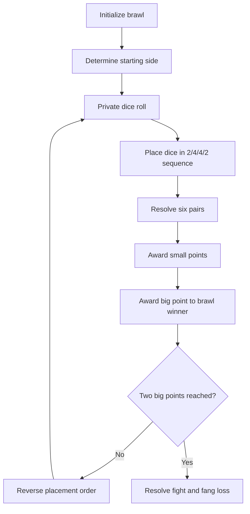

# Combat System

## Overview

Combat is a seated dice duel. In the standard rules, each participant uses **six dice** and secretly rolls on their own side of the table. The two participants then place dice in corresponding slots to form **six opposing pairs**. Each pair can score for one side or tie.

## Standard placement sequence

The opening player is chosen by a coin toss. When the player starts, the GDD describes a **2 / 4 / 4 / 2** sequence:

The placement order reverses after each brawl. The 2/4/4/2 pattern creates periods where a participant commits dice without seeing every opposing placement, followed by opportunities to react.

## Pair scoring

For a standard pair, compare the player's die result with the opposing die result:

- **Player wins the pair** if `player value - opponent value >= 2`.
- **Opponent wins the pair** if `opponent value - player value >= 2`.
- **Otherwise the pair is a tie** and awards no small point.

Each won pair grants **one small point**. The participant with more small points wins the **brawl** and receives **one big point**. The first to obtain **two big points** wins the **fight**; in the fiction, the winner knocks out a fang from the loser.
The base scoring rule is simple; the depth comes from **placement order, uncertainty, and situational exceptions**.

### Example from image

**Brawl result:** Player wins 2–0 in small points and gains one big point.

## Special cases described in the GDD

- **Fangs as dice substitutes:** a fang placed in a pair forces a tie, regardless of the opposing result. This trades a health-related resource for a defensive tactical effect.
- **Big dice:** ogres use three large dice rather than six ordinary ones. Each big die occupies **two slots** and its value counts in **both pairs**.
- **Other rule modifiers:** drinks, items and enemy abilities may alter results, remove pairs from scoring or reroll dice. See [Dice, Drinks & Items](ItemsAndDrinks.md) and [Enemy Design](EnemyDesign.md).

## State flow (conceptual)

