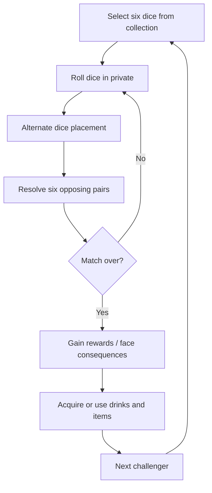

# Game Design Overview

## High concept

**Dice Brawler** is a first-person roguelite combining tactical dice placement, light deckbuilding-like loadout selection, puzzle-like encounters and rule manipulation. The player is an orc sitting at a table in a dim, dark-fantasy tavern. Challengers arrive to play dice for gold; many cheat or alter the rules. The player responds by collecting special dice, drinks and items.

**Setting and presentation:** A fixed-seat, first-person experience in a western-fantasy tavern inhabited by orcs, goblins, ogres, trolls and gnolls. Visual direction: retro low-poly 3D inspired by PS1/PSX aesthetics. Camera movement is limited to views around the table rather than free movement through the environment.

## Intended player experience

- **Tactical decisions from simple rules:** choose where to commit each die while considering the opponent's visible and hidden information.
- **Rule-breaking as progression:** expand options with unusual dice, consumables and tools rather than relying solely on higher numbers.
- **Distinct opponents:** each race or named character changes the problem the player must solve.
- **Risk and resource pressure:** health is represented by fangs; gold can be spent on helpful drinks and items.

## Core gameplay loop

The original GDD also allows visiting the waiter and using drinks/items around the central dice-play sequence. Some actions are restricted by turn, camera position or timing.

## Progression and resources

- **Fangs = health:** the introductory opponent removes one of the player's initial four fangs, leaving three. Losing all fangs ends the run; defeated opponents leave the table.
- **Gold:** awarded for victories and spent on drinks or items.
- **Dice collection:** the player chooses six dice for the active set; the draft GDD proposes a maximum collection of twelve dice.
- **Encounter variety:** opponents introduce new rules, tools, dice and opportunities to cheat.
- **Sparing opponents:** the GDD proposes that sparing certain characters may affect later encounters.

## Interaction concept

The player remains seated and shifts camera focus between table areas using W/A/S/D. Dice selection and placement use mouse interaction; the draft lists `R` to empty the dice bag and `F` to roll. The waiter can approach the table to offer drinks. These inputs and constraints are not guaranteed final controls.

